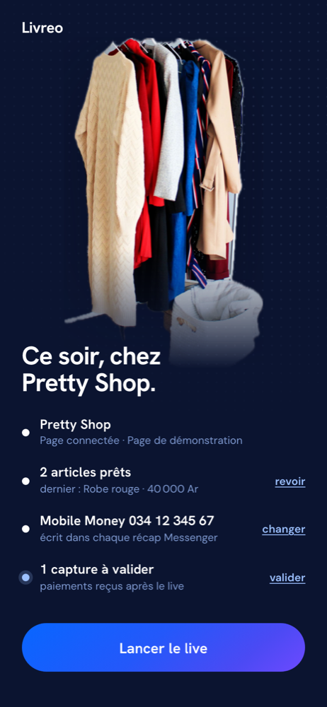

# Livreo

**Turn Facebook Live comments into paid orders.** Livreo is a sales assistant
for the women who sell clothes on Facebook Live in Madagascar: it catches every
"jp" in the comments, reserves each item for the first buyer, sends her a
recap on Messenger and checks her Mobile Money payment. The seller keeps
selling; Livreo does the bookkeeping.

Built for the **Meta Global AI Developer Hackathon 2026, Startup Track**, by a
team of four developers in Antananarivo.

| Choose the Page | Before the live | During the live | Payment check |
|---|---|---|---|
|  |  |  |  |

## The problem

In Antananarivo, a live sale works like this: the seller shows a dress, and
buyers comment **"jp"** ("j'prends", I'll take it), often dozens within a few
seconds, in French, Malagasy or both ("izaho koa jp", "jp ilay mena M").
After the live, the seller scrolls back through hundreds of comments to find
who commented first, writes to each buyer by hand, waits for Mobile Money
screenshots, checks the amounts and moves to the next buyer when someone
never pays. It takes hours, and every manual step loses sales.

## What Livreo does

One loop, four steps, while the seller is still live:

1. **Comment → reservation.** Every comment arrives through the Page webhook.
   The first clear "jp" on the item being shown wins; the others form a
   waiting list, in comment order.
2. **Recap on Messenger.** The winner gets a private reply to her comment:
   item, price, the shop's Mobile Money number and a payment deadline.
3. **Payment confirmed in one tap.** The buyer sends her screenshot on
   Messenger. Muse Spark reads the amount and reference and flags any
   mismatch; the seller confirms with one tap.
4. **Next in line.** If the deadline passes, the item goes to the next buyer
   on the list, who gets her own recap.

The seller's screen shows all of this live: current item, winner, waiting
list, and Yes/No buttons when the AI is unsure or a payment needs checking.

## How it uses Meta's AI and platform

| Building block | What Livreo does with it |
|---|---|
| **Muse Spark** (`muse-spark-1.3`, Meta Model API) | Reads each ambiguous comment (French, Malagasy, slang) into `{intention, item_ref, size, quantity, confidence}`, and reads payment screenshots into `{is_payment, amount, reference, time, confidence}`. Both use strict JSON-schema output. |
| **Graph API, Webhooks** | Receives Page comments (`feed`) and Messenger messages (`messages`), signature verified (`X-Hub-Signature-256`), stored before any processing. |
| **Graph API, Private Replies** | Answers the winning comment privately, which opens the Messenger conversation with the buyer. |
| **Messenger Platform** | Payment confirmations and refusals in the conversation the buyer opened. |
| **Facebook Login for Business** | Each seller connects her own Page; Livreo stores a non-expiring Page token, encrypted. |

AI where it helps, rules where they are enough: a plain "jp" is decided
instantly by rules (no AI latency during a burst); Muse Spark reads the
ambiguous ones, several in parallel, and decisions are still applied in
comment order so the first buyer always wins. If the Model API is down, the
rule-based parser takes over. The cheaper "Contributor" mode is deliberately
not used: it would let buyers' comments be used for training.

## Three guarantees

- **No comment lost.** The webhook writes to the database before replying to
  Meta; a delivery received twice counts once (keyed by Meta's id). When the
  live video id is known, a background task also re-reads its comments
  through the Graph API, in case a webhook is late or lost.
- **No item sold twice.** A unique index in the database refuses a second
  active winner for the same item, whatever the code does. One buyer, one
  place per item.
- **No order marked paid without proof.** The AI reads and flags; only the
  seller's tap marks an order as paid. Low-confidence comments go to her as a
  Yes/No question instead of becoming reservations.

Every message has an idempotency key, deadlines and queues live in the
database, and a restart resumes where it stopped without sending anything
twice.

## Try it

The app is a mobile-first PWA built with Next.js 14.

| Route | Screen |
|---|---|
| `/` | Landing page |
| `/essayer` | Seller home: connect with Facebook, then the pre-live checklist |
| `/essayer/page` | "Which Page tonight?" |
| `/essayer/articles` | Tonight's items, in show order |
| `/direct` | The live screen, updated in real time (Server-Sent Events) |

Without a Facebook live at hand, the replay mode feeds a recorded live
(Malagasy and French comments, a duplicate, an ambiguous one) into the real
pipeline. Open `/direct`, tap "Article suivant", then:

```bash
curl -X POST localhost:3000/api/rejeu -H 'Content-Type: application/json' \
  -d '{"vitesse":2,"garder_live":true}'
```

## Run it locally

Requires **Node.js 22.13 or later** (built-in `node:sqlite`).

```bash
cd livreo-web
cp .env.example .env.local   # every secret is optional at first
npm install
npm run dev                  # http://localhost:3000
npm test                     # 38 tests, no network
```

With no secrets, Graph API and Muse Spark run in **simulation**: messages are
logged instead of sent and the rule parser replaces the model.
`GET /api/sante` shows what is real and what is simulated.

Connecting a real Meta app (Page token, webhook, Facebook Login, Model API
key) is scripted by `outils/configurer-meta.mjs` and documented step by step
in [`livreo-web/BACKEND.md`](livreo-web/BACKEND.md).
`node outils/verifier-backend.mjs` runs a 12-step end-to-end check against a
running server.

## Repository

```
livreo-web/            Next.js app (landing, seller app, API)
  app/api/             Webhook, live, decisions, Facebook Login, replay
  app/essayer/, direct/  Seller app screens
  lib/serveur/         The loop, Graph and Muse clients, database, sessions
  tests/               Unit and scenario tests (node --test)
  BACKEND.md           API, guarantees, Meta setup, deployment
outils/                Meta setup, end-to-end check, image tools
docs/                  Order flow and API diagrams, screenshots
site/css/              Design system source
```

Order flow and API roles: [`docs/livreo-0-flux.png`](docs/livreo-0-flux.png),
[`docs/livreo-2-api.png`](docs/livreo-2-api.png).

## Security and privacy

- Page tokens encrypted at rest (AES-256-GCM); sessions stored as SHA-256
  hashes, HttpOnly cookies; OAuth `state` checked against request forgery.
- Webhook payloads verified with the app secret, compared in constant time;
  Graph calls made with a token carry `appsecret_proof`.
- Secrets live only in `.env.local`, never in the repository.

## Current limits

- The Meta app is in development mode: until Meta's app review, only accounts
  with a role in the app can connect or trigger the webhook.
- The video relay ("film inside Livreo, restream to Facebook") is not built:
  the seller goes live on Facebook and uses Livreo alongside it.
- The list of tonight's items is kept on the seller's phone, not yet on the
  server.
- One Node server with SQLite: it needs a host that stays on (Railway,
  Render, a VM), not serverless functions.
